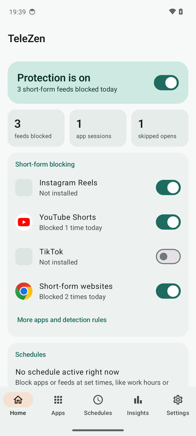
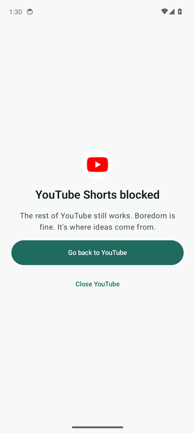
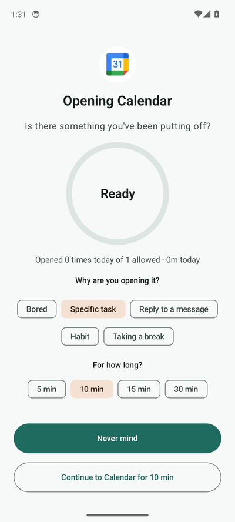
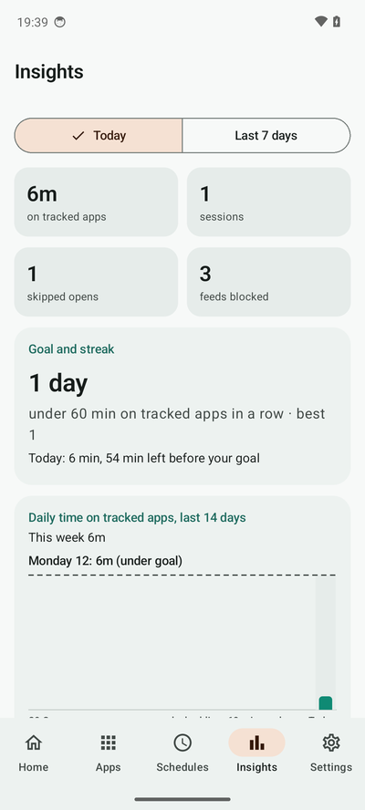
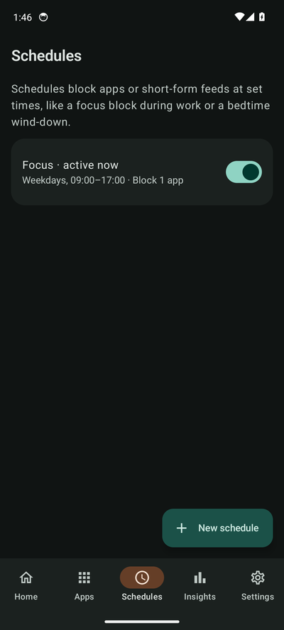

# TeleZen

**Keep the apps. Lose the endless feeds.**

TeleZen is an Android app that blocks Instagram Reels, YouTube Shorts and other short-form video feeds *without* blocking the whole app. Messages, search, profiles and long videos keep working. It also adds a mindful pause before distracting apps, daily limits, focus schedules and a strict mode for when willpower runs low.

Everything runs on your phone. TeleZen has no internet permission and collects nothing.

[](https://github.com/Swayam-H/telezen/actions/workflows/build.yml)
[](LICENSE)


<p>
  
  
  
  
  
</p>

## Features

**Block short-form feeds, keep the app**
- Instagram Reels: the Reels tab and the full-screen Reels viewer, wherever it's opened from (feed, DMs, profiles, shared links)
- YouTube Shorts: the Shorts tab and the Shorts player
- Short-form websites: `youtube.com/shorts`, `instagram.com/reels`, `facebook.com/reel` and `tiktok.com` in Chrome, Firefox, Brave, Edge and Samsung Internet
- TikTok: blocks the whole app, since all of it is a short-form feed
- Facebook Reels and Snapchat Spotlight (experimental, off by default)
- Choose what happens: go back and show a short message, or just quietly go back

**Pause before you scroll**
- A countdown screen before any app you choose, with an optional "Why are you opening this?" prompt
- Pick a session length (5–30 min); when it's up, a "Time's up" screen asks you to close the app
- Daily limits on opens and on minutes per app, with an emergency unlock that takes real effort

**Schedules**
- Block apps (or require the pause) at set times, like a focus block during work or a bedtime wind-down
- Schedules can also switch on extra feed blocking, and handle windows that cross midnight

**Insights**
- Time on tracked apps, sessions, skipped opens and blocked feeds, for today or the last 7 days
- A daily goal with a streak, a 14-day chart and an optional end-of-day summary notification

**Hard to undo on a whim**
- Strict mode (1 hour to 1 week): settings can be tightened but not loosened, emergency unlock is off, and TeleZen's pages in Android Settings are blocked so the service can't be switched off or the app uninstalled
- Optional uninstall protection (device admin) and a PIN to open TeleZen

**Also:** rotating mindful prompts, a breathing-exercise mode, settings export/import, light and dark themes, health checks that tell you when a permission is missing, and per-manufacturer tips for keeping it running.

## Install

1. Download the `TeleZen-v…apk` file from the [latest release](https://github.com/Swayam-H/telezen/releases/latest) on your phone.
2. Open it. If Android blocks it, tap **Settings**, turn on **Allow from this source**, then **Install**. If Play Protect warns about an unknown developer, tap **More details › Install anyway**.
3. Open TeleZen and follow the setup.

**Accessibility switch greyed out?** On Android 13 and newer, apps installed outside the Play Store need one extra step:
**Settings › Apps › TeleZen › ⋮ (top right) › Allow restricted settings**, then turn TeleZen on in **Settings › Accessibility**.

## How it works

TeleZen uses Android's [accessibility service](https://developer.android.com/guide/topics/ui/accessibility/service) to see which app and screen is in front. Short-form screens are recognised by detection rules in [`rules.json`](app/src/main/assets/rules.json): mostly the view IDs, selected tabs and URL-bar contents that only appear on those screens. When one matches, TeleZen presses Back for you and shows a short message. Pause screens, limits and schedules work from the same signal: which app just came to the front.

The service only inspects screens of apps whose feed blocking is currently on (plus Android Settings while strict mode is on). It never reads or stores what you type, your messages or what's in your feed.

### When a block stops working

Instagram and YouTube change their apps often, and an update can break a rule. Rules live in a plain JSON file, separate from the app code, so they can be fixed without a new release:

1. Open the feed that isn't being blocked and stay on it for about 10 seconds.
2. In TeleZen, go to **Home › More apps and detection rules › Report not working**, pick the feed and share the report. It contains the screen's view IDs and button labels, nothing else.
3. [Open a "Feed not blocked" issue](https://github.com/Swayam-H/telezen/issues/new?template=feed-not-blocked.yml) and paste it.

Fixed rules can be loaded with **Import rules** on the same screen, without reinstalling.

### Supported apps

| Feed | Status |
|---|---|
| Instagram Reels | Verified on a real phone |
| YouTube Shorts | Verified on a real phone and on Android 14 (YouTube 19.17) |
| Short-form websites | Verified in Chrome; other browsers use their known URL-bar IDs |
| TikTok (whole app) | Blocks by package name, no screen matching needed |
| Facebook Reels | Experimental, not verified |
| Snapchat Spotlight | Experimental, not verified |

## Privacy

- No internet permission: TeleZen can't send anything anywhere.
- No accounts, analytics, ads or trackers.
- Stats and settings stay in TeleZen's private storage on your phone.
- Problem reports are only ever shared by you, through Android's share sheet.

## Build from source

Requirements: JDK 17 and the Android SDK (platform 35). Android Studio works out of the box.

```sh
./gradlew testDebugUnitTest   # unit tests
./gradlew assembleDebug       # app/build/outputs/apk/debug/app-debug.apk
./gradlew assembleRelease     # minified build, signed with the debug key
```

To publish your own build, add a signing config with your own key in `app/build.gradle.kts`.

### Project layout

```
app/src/main/
├── assets/rules.json             detection rules for each feed
└── java/com/telezen/app/
    ├── service/                  accessibility service, rule matching, receivers
    ├── core/                     policy (pause/limit/schedule decisions), strict mode,
    │                             usage stats, health checks, streaks
    ├── data/                     settings store, runtime state, Room database
    ├── rules/                    rules model, parser and repository
    ├── work/                     hourly summary worker
    └── ui/                       Compose screens, pause/block screen, theme
```

The decision logic (`core/Policy.kt`, `core/Streaks.kt`, `rules/Rules.kt`) has no Android dependencies and is covered by unit tests in `app/src/test`.

## Limitations

- Android only. iOS doesn't let apps see inside other apps, so per-screen blocking isn't possible there.
- Detection depends on each app's screen layout and can break after an app update (see above).
- Changing the phone's date to the next day resets that day's limits. Moving the clock forward does *not* end strict mode early.
- Some phones (Xiaomi, Samsung, OnePlus, Oppo, Vivo, Huawei) aggressively stop background services. TeleZen shows specific steps for your phone under **Settings › Permissions & battery**.
- Google Play restricts apps that use the accessibility service for non-accessibility purposes, so TeleZen is distributed as an APK.

## License

[MIT](LICENSE)
